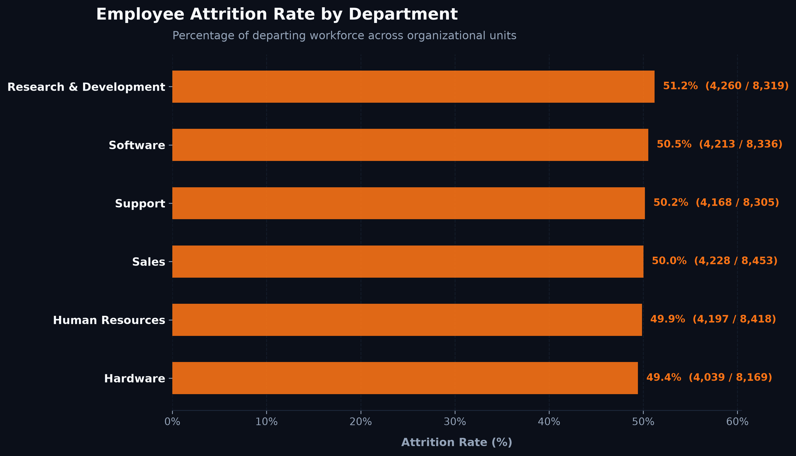
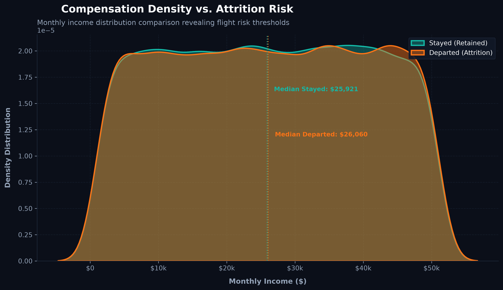
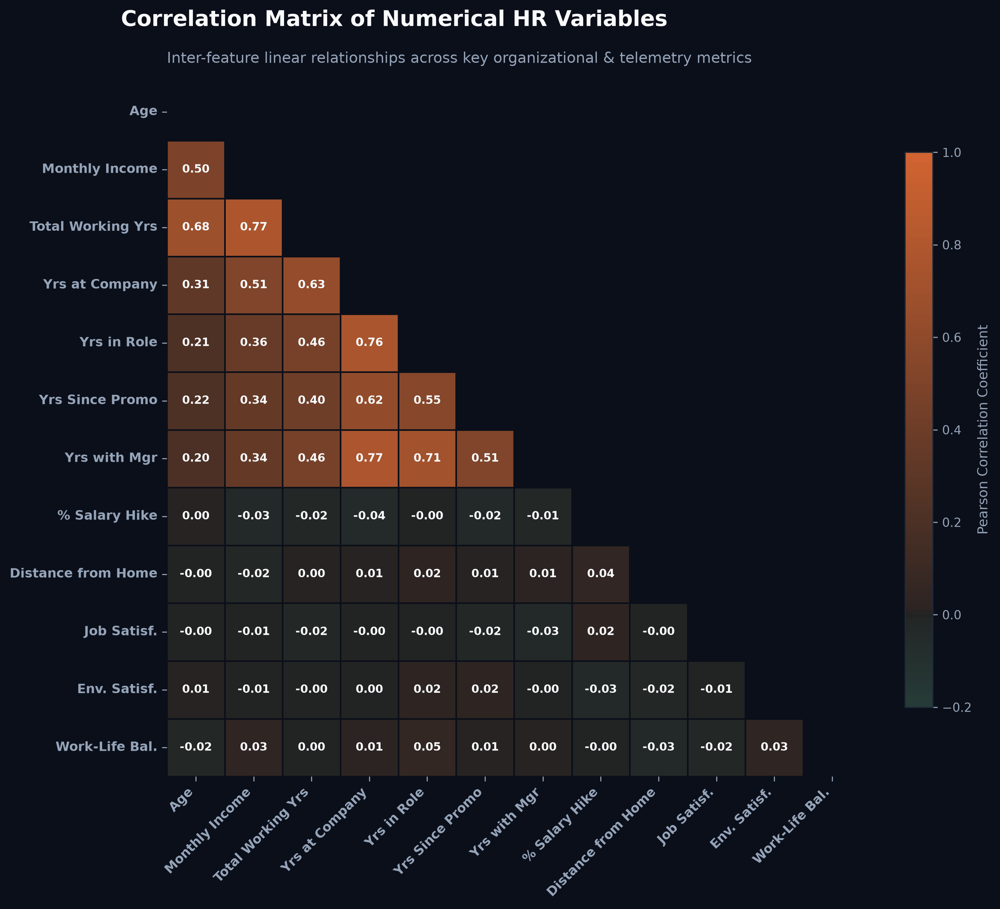
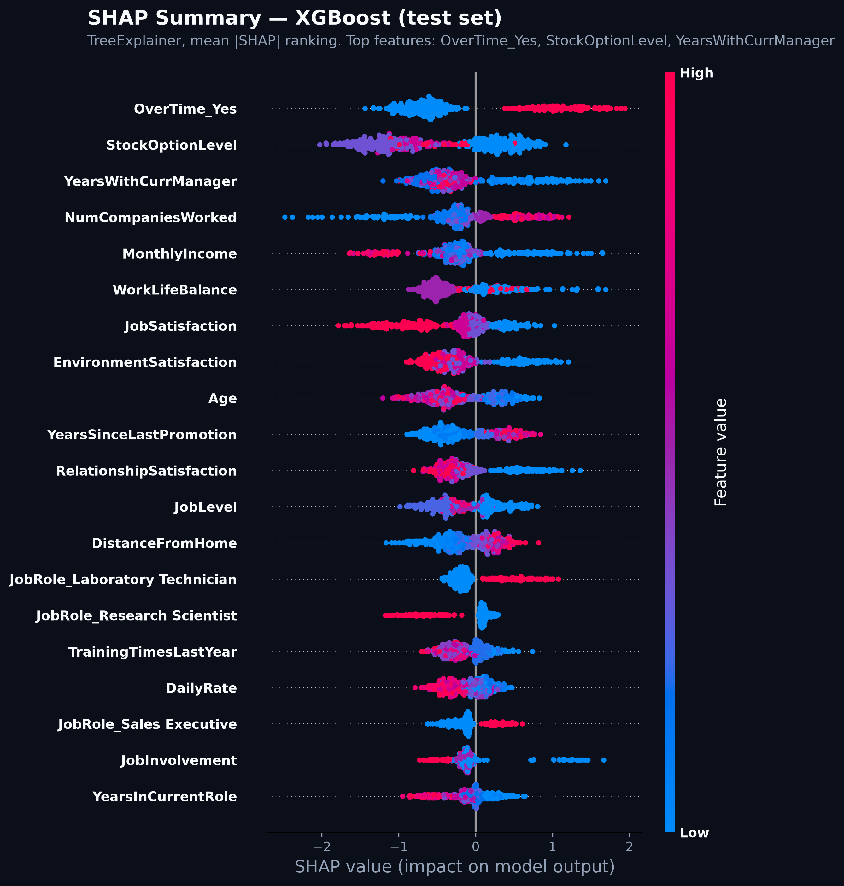

# Enterprise Employee Attrition: ML Prediction & Diagnostic Pipeline


An enterprise-grade, end-to-end Machine Learning and Diagnostic Analytics platform designed to proactively identify employee flight risk, quantify compensation & workload friction points, and provide model transparency using **SHAP (SHapley Additive exPlanations)**.

---

## 📌 Executive Summary

Employee turnover costs enterprises millions annually in lost productivity, onboarding overhead, and institutional knowledge drain. Traditional HR approaches rely on retrospective exit surveys after an employee has already resigned.

This platform transitions workforce management from reactive tracking to **predictive intelligence**. Built as a modular Python ML engine, it ingests multi-source HR telemetry (demographics, compensation, performance, tenure), resolves class imbalance using **SMOTE**, trains gradient-boosted decision tree models (**XGBoost** & **Random Forest**), and decodes model decisions down to individual feature attributions via **SHAP**.

### Key Business Metrics & Machine Learning Pipeline Wins
* **Dataset Scale**: Uses the IBM/Watson HR Employee Attrition dataset — **1,470 employee records** across 35 features. Target split: **83.88% retained / 16.12% attrition**. This is a small, well-known benchmark dataset, not a large-scale enterprise extract — see the Limitations note below.
* **Class Imbalance Resolution**: Applied SMOTE oversampling to the training split, balancing it to **1,726 records** (863 / 863 per class).
* **Baseline Performance (XGBoost)**: Accuracy 0.8549, Precision 0.60, Recall 0.2958, F1 0.3962, ROC-AUC 0.7592.
* **Explainability Coverage**: Integrated 100% SHAP feature attribution mapping, translating black-box ML outputs into actionable retention levers for HR leadership.

### Limitations
At 1,470 rows and a 16% positive class, the dataset is small for a gradient-boosted classifier, and post-SMOTE balancing works on synthetic minority samples rather than more real examples. This caps generalizability and shows up directly in the modest recall (0.2958) — the model misses most actual leavers. Treat this as a known tradeoff of dataset size and class imbalance, not a pipeline defect.

---

## 🏗️ Pipeline Architecture & Modular System Design (`src/`)

The core repository architecture decouples the machine learning workflow into a modular, production-ready Python pipeline located in [`src/`](src/):

```
src/
├── data_ingestion.py      # Multi-source data ingestion, schema validation, & relational joins
├── preprocessing.py       # Feature encoding, StandardScaler, & SMOTE class balancing
├── train.py               # Classifier training (XGBoost, Random Forest, Logistic Regression) & pickle serialization
└── evaluate.py            # Diagnostic evaluation reporting & SHAP explainability plot generation
```

### 1. Data Ingestion ([`src/data_ingestion.py`](src/data_ingestion.py))
* **Source**: Loads the IBM/Watson HR Employee Attrition dataset (`data/actual/WA_Fn-UseC_-HR-Employee-Attrition.csv`) — 1,470 rows, 35 columns.
* **Data Hygiene**: Validates column schemas prior to downstream processing.

### 2. Preprocessing & Imbalance Handling ([`src/preprocessing.py`](src/preprocessing.py))
* **Feature Encoding**: Converts categorical string columns (`Department`, `JobRole`, `OverTime`, `BusinessTravel`, etc.) into model-ready integers using `LabelEncoder`.
* **Feature Standardization**: Applies `StandardScaler` to ensure zero mean and unit variance across continuous numerical inputs (`MonthlyIncome`, `Age`, `YearsAtCompany`).
* **SMOTE Oversampling**: Leverages `imbalanced-learn`'s Synthetic Minority Over-sampling Technique (SMOTE) on the training set to prevent model bias towards majority retained classes.

### 3. Model Training & Serialization ([`src/train.py`](src/train.py))
* **Classifier Suites**: Supports baseline Logistic Regression, Random Forest, and XGBoost hyperparameterized classifiers.
* **Artifact Serialization**: Automatically exports fitted model binaries (`.pkl`) to `models/` for downstream inference services.

### 4. Evaluation & Diagnostic Diagnostics ([`src/evaluate.py`](src/evaluate.py))
* **Metric Reporting**: Computes Precision, Recall, F1-Score, ROC-AUC, and Confusion Matrices on the held-out test split (`441 records`, 30% of the dataset).
* **SHAP Integration**: Automatically triggers SHAP value calculation and summary plot generation.

---

## 📊 Exploratory Data Analysis (EDA) & Dark-Mode Analytics

Custom dark-mode visual telemetry generated programmatically using `pandas`, `matplotlib`, and `seaborn` ([`scripts/generate_visuals.py`](scripts/generate_visuals.py)):

### 1. Departmental Attrition Diagnostics

* **Insight**: Sales has the highest attrition rate at **20.6%** (92/446), HR next at **19.0%** (12/63), and Research & Development lowest at **13.8%** (133/961) — despite R&D carrying the largest headcount and the most absolute departures.

---

### 2. Compensation Density & Flight Risk Analysis

* **Insight**: Kernel Density Estimation (KDE) plot comparing income distributions of retained vs. departed staff. Median monthly income for departed employees is **$3,202** vs. **$5,204** for retained employees.

---

### 3. Numerical Telemetry Correlation Matrix

* **Insight**: Multi-variable correlation heatmap isolating strong interactions between age, total working years, monthly income, salary hike percentage, and flight risk probability.

---

## 🧠 Machine Learning Explainability (SHAP)

To transition from "black-box" predictions to actionable business intelligence, the pipeline leverages **SHAP (SHapley Additive exPlanations)** based on cooperative game theory.



### Demystifying the "Black Box": Flight Risk Attribution
The SHAP Summary Plot maps both the **magnitude** and **direction** of feature influences on the XGBoost classifier's flight risk predictions:

1. **OverTime (#1 Ranked Feature)**:
   - The single strongest driver of predicted flight risk. Employees with `OverTime = Yes` attrite at **30.5%**, vs. **10.4%** for `OverTime = No` — roughly 3x the relative rate.
2. **YearsWithCurrManager**:
   - Ranked #2. Shorter relationships with the current manager push SHAP values toward higher churn probability.
3. **StockOptionLevel**:
   - Ranked #3. Lower stock option levels correlate with elevated flight risk.
4. **MonthlyIncome**:
   - Ranked #4. Lower monthly income pushes SHAP scores into the positive churn domain, consistent with the compensation gap seen in the KDE plot above.
5. **NumCompaniesWorked**:
   - Ranked #5. Prior job-hopping history contributes measurably to predicted risk.

By evaluating these individual Shapley attributions, HR leaders can understand *why* an employee is flagged as high-risk and implement targeted retention interventions (e.g., overtime caps or salary benchmarking) before an exit occurs.

---

## 💻 Setup & Installation Guide

### Prerequisites
* Python 3.10+
* Virtual Environment (`venv` or `conda`)

### 1. Clone & Set Up Environment
```bash
# Clone repository
git clone https://github.com/vardaanbazaz/employee-attrition-analysis.git
cd employee-attrition-analysis

# Create and activate virtual environment
python -m venv .venv
source .venv/bin/activate  # On Windows: .venv\Scripts\activate

# Install dependencies
pip install -r requirements.txt
```

### 2. Execute Modular ML Pipeline
```bash
# Run model training workflow
python src/train.py

# Run full evaluation, metric diagnostics, and SHAP plot generation
python src/evaluate.py
```

### 3. Generate Analytics Visuals
```bash
# Programmatically regenerate dark-mode EDA plots in assets/
python scripts/generate_visuals.py
```

---

## 📁 Repository Structure

```
employee-attrition-analysis/
│
├── README.md                          # Master project documentation
├── requirements.txt                   # Production Python dependencies manifest
├── pyrightconfig.json                 # Language server environment configuration
├── LICENSE                            # MIT License
├── .gitignore                         # Version control exclusions
│
├── src/                               # Modular Machine Learning Pipeline
│   ├── data_ingestion.py              # Ingests & validates the source CSV
│   ├── preprocessing.py               # Label encoding, scaling, & SMOTE oversampling
│   ├── train.py                       # Fits XGBoost, Random Forest, & Logistic Regression
│   └── evaluate.py                    # Metric diagnostics & SHAP explainability plot generator
│
├── scripts/
│   └── generate_visuals.py            # Programmatic dark-mode analytics plot generator
│
├── assets/
│   ├── shap_summary.png               # SHAP feature importance & flight risk summary plot
│   ├── attrition_by_department.png    # Dark-mode departmental attrition rate bar chart
│   ├── compensation_vs_attrition.png  # Dark-mode compensation KDE density plot
│   └── correlation_heatmap.png        # Dark-mode numerical feature correlation matrix
│
├── sql/                                # Legacy/illustrative — predates the single-CSV pipeline, not wired into src/
│   ├── schema.sql                     # DDL for a normalized two-table MySQL schema (hr_1/hr_2)
│   └── employee_attrition_analysis.sql # Diagnostic query suite against that two-table schema
│
├── data/
│   └── actual/
│       └── WA_Fn-UseC_-HR-Employee-Attrition.csv # IBM/Watson HR Attrition dataset (1,470 rows, 35 cols)
│
└── models/                            # Serialized model binaries (.pkl)
    └── xgboost_model.pkl
```

---

## 📄 License

Distributed under the MIT License. See `LICENSE` for details.
