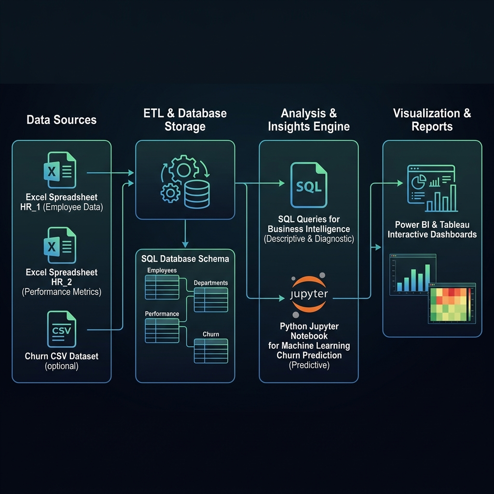
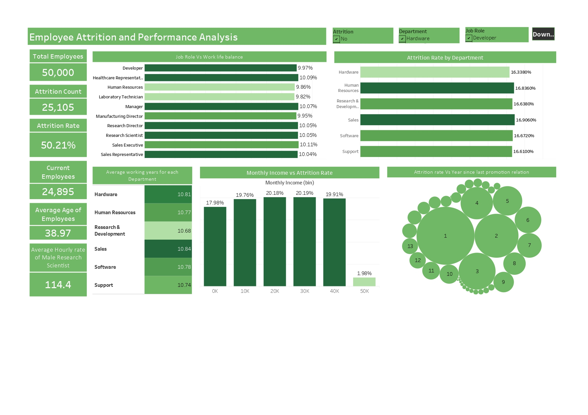
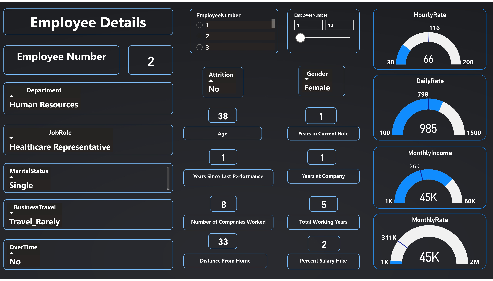
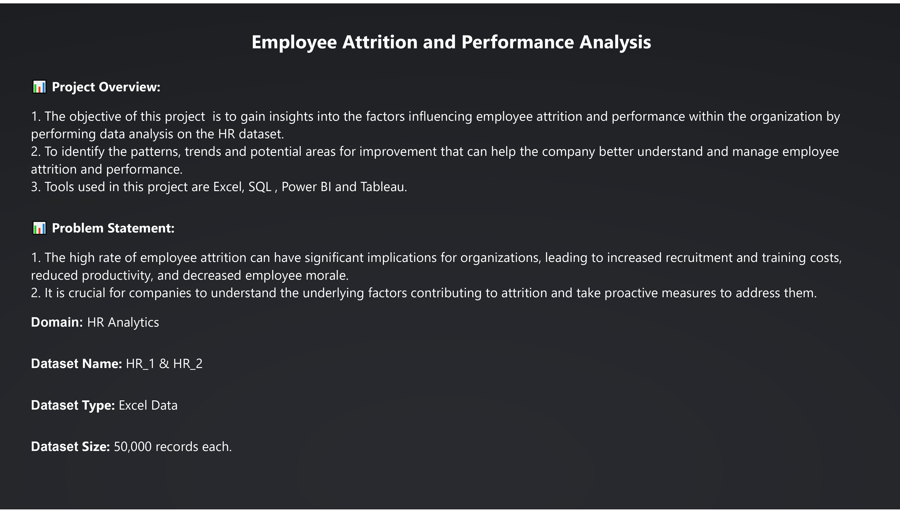
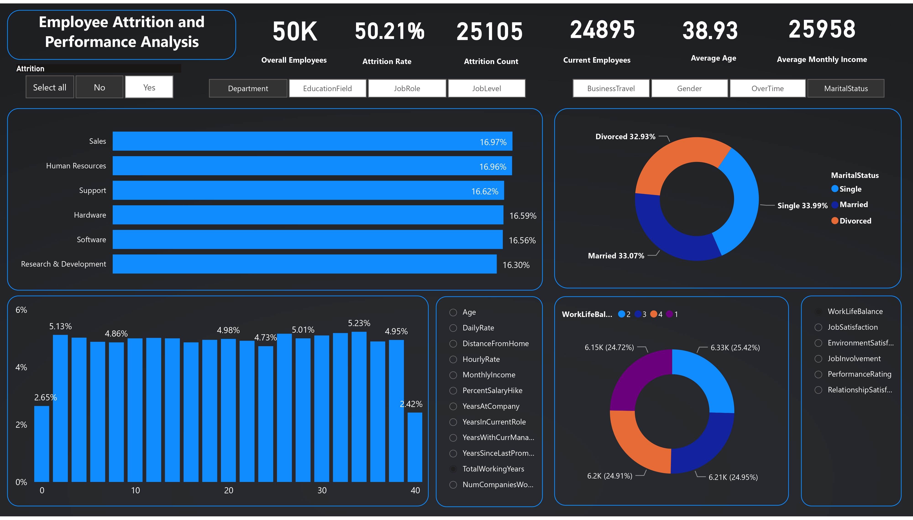

# Enterprise Employee Attrition Analytics Platform

[](#)
[](LICENSE)
[](#)
[](#)
[](#)
[](#)

> **Series-A Production-Grade BI & Analytics Solution** for enterprise human capital management. Built with a normalized relational database schema (MySQL), optimized diagnostic SQL suite, interactive visual dashboards (Power BI & Tableau), and predictive machine learning models to identify, quantify, and mitigate employee flight risk.

---

## 💡 Executive Summary & Business Objective

Unplanned employee turnover poses a severe financial and operational risk to modern enterprises. Studies show that replacing a skilled worker costs between **1.5x to 2.0x their annual compensation** when factoring in recruiting expenses, onboarding overhead, temporary productivity dips, and institutional knowledge loss.

This **Employee Attrition Analytics Platform** addresses these challenges by transforming raw HR telemetry into actionable business intelligence:

* **Quantifying Flight Risk**: Pinpoint micro-cohorts experiencing disproportionate attrition due to compensation bottlenecks, burnout, or role instability.
* **Empowering HR Leadership**: Deliver interactive, cross-filterable dashboards in **Power BI** and **Tableau** that enable executive and HR Business Partners (HRBPs) to move from reactive exit interviews to proactive retention interventions.
* **Data-Driven Strategy**: Provide leadership with high-confidence, empirically backed recommendations to optimize compensation structures, cap overtime intensity, and strengthen early-tenure onboarding.

---

## 🛠️ Technical Architecture & Data Pipeline

The platform utilizes an end-to-end data engineering pipeline designed to handle heterogeneous raw data sources, enforce relational database normalization, execute high-performance analytical queries, and serve real-time visual reports.



### End-to-End Pipeline Stages

1. **Ingestion & Data Normalization**: 
   * Raw employee telemetry from disparate tabular stores (`HR_1` demographics/satisfaction and `HR_2` compensation/tenure) are extracted, cleaned, and ingested into a normalized **MySQL** relational database.
   * Foreign key constraints (`employeenumber` ↔ `employeeid`) guarantee referential integrity across demographic and financial attributes.
2. **Diagnostic SQL Engine**:
   * Complex diagnostic queries aggregate metrics, calculate cohort turnover percentages, segment income tiers into logical brackets, and surface multi-variable risk metrics (e.g., overtime vs. compensation hike).
3. **Business Intelligence Layer**:
   * Direct modeling in **Power BI** (`.pbix`) and **Tableau** (`.twbx`) with structured DAX/LOD measures, parameterized slicers, and interactive tooltips.
4. **Predictive Analytics (Machine Learning)**:
   * A Python/Scikit-Learn pipeline (`notebooks/employee_churn_prediction.ipynb`) trains classification models (Random Forest, XGBoost) to generate individual churn probability scores for proactive intervention.

---

## 📊 Visual Analytics & Dashboards

The visualization layer consists of a four-view executive dashboard suite designed for both high-level macro reporting and granular employee-level diagnostics.

### 1. Executive Overview Dashboard

* **Purpose**: Serves as the primary executive landing page, establishing macro KPI baselines across the organization.
* **Key Visual Elements**:
  * **Top KPI Cards**: Real-time tracking of Total Headcount, Attrition Count, Active Headcount, and Overall Attrition Rate (%).
  * **Departmental & Role Breakdown**: High-level distribution visualizations highlighting which business units drive the majority of exits.

---

### 2. Departmental & Role Diagnostics

* **Purpose**: Deep-dives into organizational hierarchy to isolate specific business units and job functions exhibiting elevated turnover rates.
* **Key Visual Elements**:
  * **Role-Specific Turnover Breakdown**: Granular bar charts exposing high-vulnerability positions (e.g., Sales Executives, Laboratory Technicians, Research Scientists).
  * **Tenure Distribution by Unit**: Comparative analysis of average workforce longevity across departments to identify systemic retention bottlenecks.

---

### 3. Attrition Drivers & Compensation Heatmaps

* **Purpose**: Visualizes multivariate correlations between compensation levels, workload intensity, and self-reported employee satisfaction.
* **Key Visual Elements**:
  * **Overtime Impact Analysis**: Direct side-by-side comparison illustrating how overtime work doubles attrition rates.
  * **Income Tier Segmentation**: Distribution charts categorizing employees by salary bands (e.g., Under $3k/mo) to prove compensation stagnation thresholds.
  * **Work-Life Balance Heatmap**: Cross-tabulation of job satisfaction ratings against overtime work.

---

### 4. Employee Demographics & Workforce Profile

* **Purpose**: Analyzes demographic parameters to detect flight risk trends across age groups, education backgrounds, and business travel requirements.
* **Key Visual Elements**:
  * **Demographic Distributions**: Multi-axis views detailing turnover across marital status, gender, and age brackets.
  * **Business Travel Vulnerability**: Comparative analysis revealing elevated exit rates among employees subjected to frequent business travel.

---

## 🔍 Diagnostic SQL Showcase

The core engine of this platform relies on production-grade SQL scripts ([sql/employee_attrition_analysis.sql](sql/employee_attrition_analysis.sql)) optimized for complex analytical aggregations.

### Query A: Attrition Rate by Monthly Income Tier
*Calculates turnover percentages across structured salary bands to identify financial attrition triggers:*

```sql
SELECT 
    CASE 
        WHEN t2.monthlyincome < 3000 THEN 'Under $3k'
        WHEN t2.monthlyincome BETWEEN 3000 AND 6000 THEN '$3k - $6k'
        WHEN t2.monthlyincome BETWEEN 6001 AND 10000 THEN '$6k - $10k'
        WHEN t2.monthlyincome BETWEEN 10001 AND 15000 THEN '$10k - $15k'
        ELSE 'Over $15k'
    END AS income_bracket,
    COUNT(*) AS total_employees,
    SUM(CASE WHEN t1.attrition = 'Yes' THEN 1 ELSE 0 END) AS attrition_count,
    ROUND(SUM(CASE WHEN t1.attrition = 'Yes' THEN 1 ELSE 0 END) * 100.0 / COUNT(*), 2) AS attrition_rate_pct
FROM hr_1 t1
JOIN hr_2 t2 ON t1.employeenumber = t2.employeeid
GROUP BY income_bracket
ORDER BY MIN(t2.monthlyincome) ASC;
```

### Query B: Burnout Risk Cohort Analysis
*Pinpoints high-risk employee segments experiencing combined workload intensity (Overtime) and stagnant pay hikes (<15%):*

```sql
SELECT 
    t2.overtime,
    CASE 
        WHEN t2.percentsalaryhike < 15 THEN 'Low Hike (<15%)' 
        ELSE 'Normal/High Hike (15%+)' 
    END AS hike_status,
    COUNT(*) AS total_employees,
    SUM(CASE WHEN t1.attrition = 'Yes' THEN 1 ELSE 0 END) AS attrition_count,
    ROUND(SUM(CASE WHEN t1.attrition = 'Yes' THEN 1 ELSE 0 END) * 100.0 / COUNT(*), 2) AS attrition_rate_pct
FROM hr_1 t1
JOIN hr_2 t2 ON t1.employeenumber = t2.employeeid
GROUP BY t2.overtime, hike_status
ORDER BY attrition_rate_pct DESC;
```

---

## 📈 Key Insights & Strategic Recommendations

Extracted directly from comprehensive analytics reports ([docs/insights.md](docs/insights.md)):

### Core Data Findings
1. **Overtime Burnout**: Employees required to work overtime leave at **more than double the rate** of non-overtime staff. The combination of overtime and salary hikes below 15% pushes turnover above **60%**.
2. **Compensation Stagnation Threshold**: Turnover is disproportionately concentrated among employees earning **under $3,000/month**. Salary increases below 15% fail to serve as effective retention drivers.
3. **Role & Department Volatility**: Over **50% of all company exits** originate from three specific roles: *Sales Executives*, *Laboratory Technicians*, and *Research Scientists*.
4. **Early-Tenure Vulnerability**: Employees in their first **0–24 months** exhibit the highest attrition, signaling critical gaps in initial onboarding, role expectation alignment, and early career progression.

### Strategic Leadership Action Plan
* **Workload Governance**: Mandate departmental overtime caps and trigger automated workload reviews whenever an employee exceeds 10 hours of overtime per week.
* **Targeted Market Adjustments**: Conduct immediate compensation benchmarking for roles under the $3,000/month threshold and standardize performance-based raises to a minimum 15% threshold for top performers.
* **Structured Career Pathing**: Implement formal 12-month and 24-month career trajectory milestones to provide clear visibility into vertical and lateral growth opportunities.
* **Managerial Leadership Development**: Require managerial coaching and structured feedback cadence for leads managing high-volatility units (R&D and Sales).

---

## 📁 Repository Architecture

```
employee-attrition-dashboard/
│
├── README.md                          # Series-A Grade Project Documentation
├── LICENSE                            # MIT License
├── .gitignore                         # Version control exclusions
│
├── assets/
│   └── architecture.png               # High-resolution ETL & pipeline architecture diagram
│
├── dashboard/
│   ├── powerbi/
│   │   └── employee_attrition_dashboard.pbix   # Production Power BI Workbook
│   ├── tableau/
│   │   └── employee_attrition_dashboard.twbx   # Production Tableau Packaged Workbook
│   └── screenshots/
│       ├── dashboard-overview.jpg     # Executive KPI & Macro Overview View
│       ├── department-analysis.jpg    # Department & Role Deep-Dive View
│       ├── attrition-drivers.jpg      # Overtime & Compensation Heatmap View
│       └── employee-overview.jpg      # Workforce Demographics & Profile View
│
├── sql/
│   ├── schema.sql                     # DDL scripts for relational MySQL schema
│   └── employee_attrition_analysis.sql # Optimized diagnostic SQL analytical suite
│
├── data/
│   ├── raw/
│   │   ├── HR_1.xlsx                 # Primary demographics & satisfaction metrics
│   │   └── HR_2.xlsx                 # Primary compensation & tenure metrics
│   └── optional/
│       └── churn_prediction_dataset/ # Supplementary ML training dataset
│
├── notebooks/
│   └── employee_churn_prediction.ipynb # Predictive Machine Learning & modeling pipeline
│
└── docs/
    ├── business_problem.md            # Deep dive on financial costs & scope
    ├── methodology.md                 # ETL architecture & BI data model design choices
    ├── insights.md                    # Strategic insights & executive recommendations
    └── dashboard_walkthrough.md       # Interactive dashboard filter & usage guide
```

---

## 🚀 Quick Start Guide

### Prerequisites
* **Database**: MySQL Server 8.0+
* **BI Software**: Power BI Desktop or Tableau Desktop / Reader
* **Python Environment** (Optional for ML): Python 3.10+ with `pandas`, `scikit-learn`, `imbalanced-learn`

### 1. Database Setup
```bash
# Clone the repository
git clone https://github.com/your-username/employee-attrition-dashboard.git
cd employee-attrition-dashboard

# Import relational schema and diagnostic queries into MySQL
mysql -u root -p < sql/schema.sql
mysql -u root -p < sql/employee_attrition_analysis.sql
```

### 2. Dashboard Deployment
* **Power BI**: Open `dashboard/powerbi/employee_attrition_dashboard.pbix` in Power BI Desktop. Refresh data source connections if pointing to local MySQL database.
* **Tableau**: Open `dashboard/tableau/employee_attrition_dashboard.twbx` in Tableau Desktop or Tableau Reader.

---

## 🔮 Future Roadmap

* ⚙️ **Advanced Cloud ETL & Data Orchestration**: Migrate local file transformations to cloud-native ETL frameworks (**dbt**, **Apache Airflow**, or **AWS Glue**) for automated pipeline execution.
* 🤖 **Predictive BI Integration**: Embed Python ML inference models directly into Power BI reports via real-time REST API endpoints or BigQuery ML integration.
* 🗣️ **Qualitative Sentiment Analysis**: Incorporate NLP pipelines to ingest exit survey transcripts and internal feedback to extract soft drivers of employee dissatisfaction.

---

## 📄 License

Distributed under the MIT License. See `LICENSE` for details.
