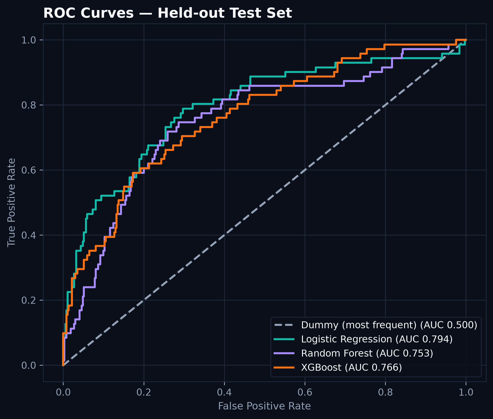
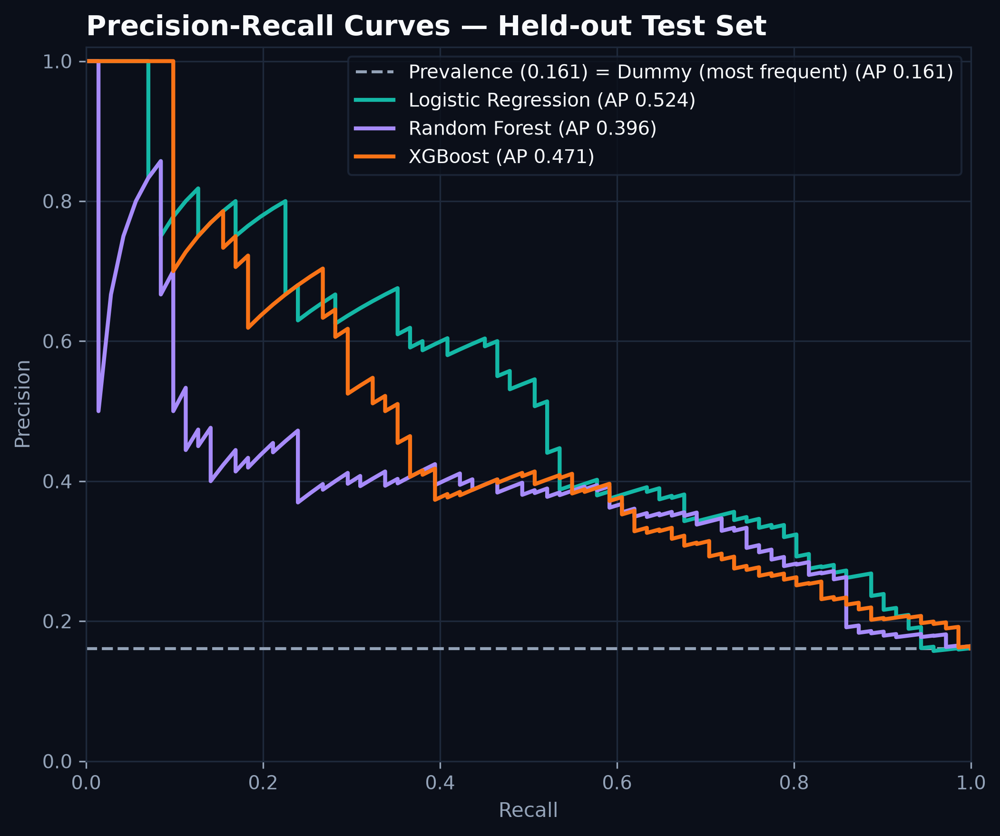
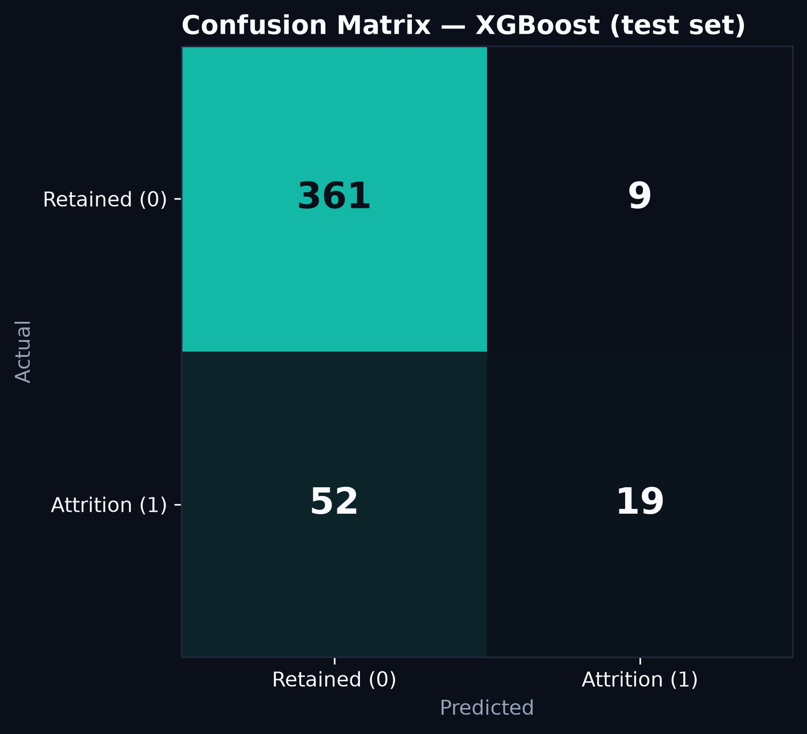

# Employee Attrition: ML Prediction & SHAP Explainability


An employee attrition classifier trained on IBM's fictional HR Attrition dataset. It compares four models (a dummy baseline, Logistic Regression, Random Forest and XGBoost), selects one by cross-validated PR-AUC on the training split only, and explains the selected model with **SHAP (SHapley Additive exPlanations)**.

---

## 📌 Overview

* **Dataset**: 1,470 employee records; 35 columns, 30 raw features, 47 after encoding. 16.1% of employees left (`Attrition = Yes`).
* **Split**: one stratified 70/30 split, 1,029 training rows and 441 test rows, `random_state=42` throughout.
* **Class imbalance**: SMOTENC oversamples the minority class inside each training fit, taking the training set from 863 / 166 to 863 / 863 (retained / left). The test set is never resampled.
* **Model selection**: stratified 5-fold cross-validation on the training split. The model with the best mean CV PR-AUC is the headline model (tiebreak: mean CV F1). The test set is used only for final reporting.

---

## 🎯 Results

All numbers below come from [`assets/metrics.json`](assets/metrics.json), written by `src/evaluate.py`. Test metrics use the default 0.5 decision threshold.

| Model | CV PR-AUC (mean ± std) | Test PR-AUC | Test F1 | Test ROC-AUC | Test Precision | Test Recall | Test Accuracy |
|---|---|---|---|---|---|---|---|
| Dummy (most frequent) | 0.161 ± 0.002 | 0.161 | 0.000 | 0.500 | 0.000 | 0.000 | 0.839 |
| Logistic Regression | 0.577 ± 0.076 | 0.524 | 0.455 | 0.794 | 0.396 | 0.535 | 0.794 |
| Random Forest | 0.544 ± 0.058 | 0.396 | 0.346 | 0.753 | 0.393 | 0.310 | 0.812 |
| **XGBoost** (headline) | 0.578 ± 0.055 | 0.471 | 0.384 | 0.766 | 0.679 | 0.268 | 0.862 |

Accuracy is misleading here: always predicting "stays" (the dummy model) already scores 83.9% on the test set.

XGBoost was selected by the pre-declared rule (best mean CV PR-AUC), but it is statistically tied with Logistic Regression: their CV PR-AUC differs by 0.0003, far less than one standard deviation (0.055 and 0.076). At the 0.5 threshold they differ mainly in the precision/recall trade-off. On the test set XGBoost has precision 0.679 and recall 0.268, while Logistic Regression has precision 0.396 and recall 0.535. Logistic Regression also has the higher test PR-AUC (0.524 vs 0.471); the selection was made on CV PR-AUC, not on test results. Tuning the decision threshold is the next improvement.





The dashed line in the PR plot is the test-set prevalence (0.161), which is also what the dummy model scores.



### Limitations
* **Fictional data**: the dataset was created by IBM data scientists; findings describe this dataset, not real employees.
* **Small sample**: 1,470 rows, with 71 leavers in the test set, so test metrics move noticeably with a few predictions.
* **Tied models**: the XGBoost / Logistic Regression ranking is within CV noise (see above).
* **Fixed hyperparameters**: no tuning was done for any model.
* **Fixed threshold**: all test precision, recall, F1 and accuracy figures use a 0.5 threshold.
* **Limited validation**: one held-out split plus 5-fold CV on the training rows; no repeated splits or external data.

---

## 🗃️ Data Source & License

* **Source**: [IBM HR Analytics Employee Attrition & Performance (Kaggle)](https://www.kaggle.com/datasets/pavansubhasht/ibm-hr-analytics-attrition-dataset)
* A fictional dataset created by IBM data scientists (IBM Watson Analytics sample). 1,470 rows x 35 columns.
* **License**: [ODbL 1.0](https://opendatacommons.org/licenses/odbl/1-0/) for the database, [DbCL 1.0](https://opendatacommons.org/licenses/dbcl/1-0/) for the contents.

---

## 🏗️ Pipeline (`src/`)

```
src/
├── data_ingestion.py      # Loads the single source CSV
├── preprocessing.py       # Cleaning, the fixed split, and the scale -> SMOTENC -> encode steps
├── train.py               # 5-fold CV of all four models, headline selection, saves fitted pipelines
└── evaluate.py            # Loads saved pipelines, test metrics, ROC/PR/confusion/SHAP plots, metrics.json
```

### 1. Data Ingestion ([`src/data_ingestion.py`](src/data_ingestion.py))
* Loads `data/actual/WA_Fn-UseC_-HR-Employee-Attrition.csv` with `utf-8-sig` encoding (strips the file's BOM).
* Checks that the file exists before reading it.

### 2. Preprocessing ([`src/preprocessing.py`](src/preprocessing.py))
* Drops `EmployeeNumber`, `EmployeeCount`, `StandardHours` and `Over18`, and maps `Attrition` Yes/No to 1/0.
* Each model is wrapped in one `imblearn` `Pipeline`, fitted on training data only:
  1. `StandardScaler` on the numeric columns.
  2. `SMOTENC` while the categorical columns are still unencoded (runs during fitting only).
  3. Categorical encoding: `BusinessTravel` as ordinal (Non-Travel=0, Travel_Rarely=1, Travel_Frequently=2); `Gender` and `OverTime` one-hot with `drop='if_binary'`; `Department`, `JobRole`, `MaritalStatus`, `EducationField` one-hot with `handle_unknown='ignore'`.
  4. The classifier.

### 3. Training ([`src/train.py`](src/train.py))
* Cross-validates the dummy baseline, Logistic Regression, Random Forest and XGBoost with fixed hyperparameters.
* Refits every pipeline on the full training split and saves it to `models/` with `joblib`, along with the CV summary.

### 4. Evaluation ([`src/evaluate.py`](src/evaluate.py))
* Loads the saved pipelines (no retraining; it tells you to run `train.py` first if they are missing).
* Reports accuracy, precision, recall, F1, ROC-AUC and PR-AUC on the 441-row test split, writes `assets/metrics.json`, and draws the ROC, PR, confusion-matrix and SHAP plots.

---

## 📊 Exploratory Data Analysis

Plots generated by [`scripts/generate_visuals.py`](scripts/generate_visuals.py). Figures below are computed on all 1,470 rows.

### 1. Attrition by Department

* In this dataset, Sales has the highest attrition rate at 20.6% (92/446), Human Resources 19.0% (12/63), and Research & Development the lowest at 13.8% (133/961), although R&D has the most leavers in absolute terms.

### 2. Monthly Income vs Attrition

* In this dataset, the median monthly income of employees who left is 3,202, versus 5,204 for those who stayed.

### 3. Correlation Heatmap

* Pearson correlations between 12 numeric features (age, income, tenure, satisfaction and related columns). The target (`Attrition`) is not included.

### 4. Overtime
* In this dataset, employees who work overtime left at 30.5% (127/416), versus 10.4% (110/1,054) for those who don't. There is no plot for this.

---

## 🧠 Explainability (SHAP)

SHAP values are computed for the headline model (XGBoost, via `TreeExplainer`) on the encoded test set.


In this dataset, the model relies most on these features, ranked by mean |SHAP value| (from `assets/metrics.json`):

| Rank | Feature | Mean \|SHAP\| |
|---|---|---|
| 1 | OverTime_Yes | 0.807 |
| 2 | StockOptionLevel | 0.771 |
| 3 | YearsWithCurrManager | 0.513 |
| 4 | NumCompaniesWorked | 0.467 |
| 5 | MonthlyIncome | 0.450 |
| 6 | WorkLifeBalance | 0.439 |
| 7 | JobSatisfaction | 0.436 |
| 8 | EnvironmentSatisfaction | 0.417 |
| 9 | Age | 0.405 |
| 10 | YearsSinceLastPromotion | 0.390 |

The plot above shows the direction of each feature's effect. These are associations the model learned from fictional data, not causes; they do not prove that changing a feature would change whether someone leaves.

---

## 💻 Setup

### Prerequisites
* Python 3.12+ (tested on 3.14.8)
* A virtual environment (`venv` or `conda`)

### 1. Clone & Set Up Environment
```bash
git clone https://github.com/vardaanbazaz/employee-attrition-analysis.git
cd employee-attrition-analysis

python -m venv .venv
source .venv/bin/activate  # On Windows: .venv\Scripts\activate

pip install -r requirements.txt
```

### 2. Train, then Evaluate
```bash
# Cross-validate all models, pick the headline, save pipelines to models/
python src/train.py

# Load the saved pipelines, write assets/metrics.json and the result plots
python src/evaluate.py
```

### 3. EDA Plots
```bash
python scripts/generate_visuals.py
```

---

## 📁 Repository Structure

```
employee-attrition-analysis/
│
├── README.md
├── requirements.txt                   # Exact pinned dependency versions
├── pyrightconfig.json                 # Language server configuration
├── LICENSE                            # MIT License (code only)
├── .gitignore
├── decisions.md                       # Log of technical decisions
├── flow.md                            # Execution flow and call graph
│
├── docs/
│   └── business_problem.md            # Problem framing and project objectives
│
├── src/
│   ├── data_ingestion.py              # Loads the source CSV
│   ├── preprocessing.py               # Cleaning, split, scale -> SMOTENC -> encode steps
│   ├── train.py                       # CV, headline selection, saves pipelines
│   └── evaluate.py                    # Test metrics, plots, metrics.json
│
├── scripts/
│   └── generate_visuals.py            # EDA plot generator
│
├── assets/
│   ├── metrics.json                   # CV and test metrics, headline model, top SHAP features
│   ├── roc_curves.png                 # Test-set ROC curves, all models
│   ├── pr_curves.png                  # Test-set precision-recall curves with prevalence line
│   ├── confusion_matrix.png           # Headline model, test set
│   ├── shap_summary.png               # SHAP summary plot, headline model
│   ├── attrition_by_department.png    # EDA: attrition rate by department
│   ├── compensation_vs_attrition.png  # EDA: monthly income density by attrition
│   └── correlation_heatmap.png        # EDA: numeric feature correlations
│
├── data/
│   └── actual/
│       ├── README.md                  # Dataset source & license
│       └── WA_Fn-UseC_-HR-Employee-Attrition.csv
│
└── models/                            # Gitignored; created by src/train.py
    ├── dummy_pipeline.pkl
    ├── logistic_regression_pipeline.pkl
    ├── random_forest_pipeline.pkl
    ├── xgboost_pipeline.pkl
    └── cv_results.pkl
```

---

## 📄 License

The MIT License (see `LICENSE`) covers code written in this repo only; the dataset in `data/` is not covered by it and is under [ODbL 1.0](https://opendatacommons.org/licenses/odbl/1-0/) / [DbCL 1.0](https://opendatacommons.org/licenses/dbcl/1-0/).
