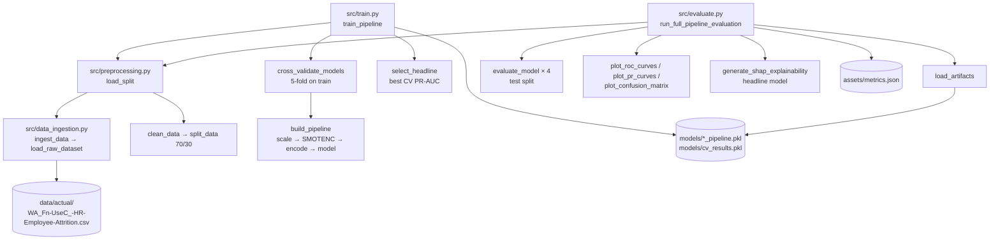

# Execution Flow

How execution moves through the code. Paths are relative to the repo root;
calls use `file.py:function` notation.

## Entry points

All entry points are plain scripts run from the repo root with the project
`.venv` active. There is no server, CLI framework, or background job.

| Command | Entry function | Purpose |
|---|---|---|
| `python src/train.py` | `src/train.py:train_pipeline` | 5-fold CV of all four models on the training split, pick headline, refit and save every pipeline to `models/` |
| `python src/evaluate.py` | `src/evaluate.py:run_full_pipeline_evaluation` | Load saved pipelines, score the test split, write `assets/metrics.json` and the ROC/PR/confusion/SHAP plots |
| `python scripts/generate_visuals.py` | `scripts/generate_visuals.py:main` | Write the three EDA plots to `assets/` |
| `python src/preprocessing.py` | `__main__` block | Smoke test: split shapes, SMOTENC class counts, encoded feature count |
| `python src/data_ingestion.py` | `__main__` block | Smoke test: print head and class counts |

`src/train.py` must run before `src/evaluate.py`. `evaluate.py` never
retrains; if any `models/*.pkl` artifact is missing it raises
`FileNotFoundError` telling you to run `python src/train.py` first.

Both scripts rebuild the same split independently through
`src/preprocessing.py:load_split` (`random_state=42`).

## Pipeline steps (one imblearn `Pipeline` per model)

Built by `src/train.py:build_pipeline` from `src/preprocessing.py:build_preprocessing_steps`:

1. `scale`: `ColumnTransformer` with `StandardScaler` on numeric columns; categoricals pass through as strings
2. `smotenc`: `SMOTENC` on the 7 categorical columns (runs during `fit` only; skipped by `predict`/`transform`)
3. `encode`: `ColumnTransformer`: `OrdinalEncoder` for `BusinessTravel`, `OneHotEncoder(drop='if_binary')` for `Gender`/`OverTime`, `OneHotEncoder(handle_unknown='ignore')` for the other 4 nominals
4. `model`: one of `src/train.py:make_models` (dummy, logistic_regression, random_forest, xgboost)

## Training path: `python src/train.py`

1. `src/train.py:train_pipeline`
2. → `src/preprocessing.py:load_split`
   1. → `src/data_ingestion.py:ingest_data` → `src/data_ingestion.py:load_raw_dataset` (checks the CSV exists, reads it with `utf-8-sig`)
   2. → `src/preprocessing.py:clean_data`: drop ID/constant columns, map `Attrition` Yes/No to 1/0
   3. → `src/preprocessing.py:split_data`: `train_test_split(test_size=0.3, stratify=y, random_state=42)`
3. → `src/train.py:cross_validate_models`: for each `make_models` entry, `cross_validate` the `build_pipeline` result on the training split (`StratifiedKFold(5, shuffle=True, random_state=42)`)
4. → `src/train.py:select_headline`: best mean CV PR-AUC, tiebreak mean CV F1
5. For each model: `build_pipeline(...).fit(X_train, y_train)` → `src/train.py:save_model` → `models/<name>_pipeline.pkl`
6. Scale + SMOTENC re-run alone to record class counts → `save_model` → `models/cv_results.pkl`

## Evaluation path: `python src/evaluate.py`

1. `src/evaluate.py:run_full_pipeline_evaluation`
2. → `src/evaluate.py:load_artifacts`: `joblib.load` of `models/cv_results.pkl` and the four `models/*_pipeline.pkl`
3. → `src/preprocessing.py:load_split` (same split as training)
4. → `src/evaluate.py:evaluate_model` for each pipeline: test accuracy, precision, recall, F1, ROC-AUC, PR-AUC, confusion matrix
5. → `src/evaluate.py:plot_roc_curves` → `assets/roc_curves.png`
6. → `src/evaluate.py:plot_pr_curves` → `assets/pr_curves.png`
7. → `src/evaluate.py:plot_confusion_matrix` (headline) → `assets/confusion_matrix.png`
8. → `src/evaluate.py:generate_shap_explainability` (headline; `LinearExplainer` or `TreeExplainer`) → `assets/shap_summary.png`
9. Write `assets/metrics.json`, then `src/evaluate.py:print_results_table`

## Visuals path: `python scripts/generate_visuals.py`

1. `scripts/generate_visuals.py:main`
2. → `scripts/generate_visuals.py:load_data` → `src/data_ingestion.py:ingest_data`
3. → `scripts/generate_visuals.py:generate_attrition_by_department` → `assets/attrition_by_department.png`
4. → `scripts/generate_visuals.py:generate_compensation_vs_attrition` → `assets/compensation_vs_attrition.png`
5. → `scripts/generate_visuals.py:generate_correlation_heatmap` → `assets/correlation_heatmap.png`

Each plot function calls `scripts/generate_visuals.py:set_dark_theme` first.
