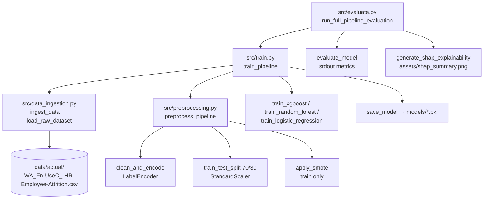

# Execution Flow

How execution moves through the code. Paths are relative to the repo root;
calls use `file.py:function` notation.

## Entry points

All entry points are plain scripts run from the repo root with the project
`.venv` active. There is no server, CLI framework, or background job.

| Command | Entry function | Purpose |
|---|---|---|
| `python src/train.py` | `src/train.py:train_pipeline(model_type="xgboost")` | Ingest, preprocess, fit XGBoost, save `models/xgboost_model.pkl` |
| `python src/evaluate.py` | `src/evaluate.py:run_full_pipeline_evaluation(model_type="xgboost")` | Retrain (via `train_pipeline`), print test metrics, write `assets/shap_summary.png` |
| `python scripts/generate_visuals.py` | `scripts/generate_visuals.py:main` | Write the three EDA plots to `assets/` |
| `python src/preprocessing.py` | `__main__` block | Smoke test: print split shapes |
| `python src/data_ingestion.py` | `__main__` block | Smoke test: print head and class counts |

`src/evaluate.py` does not load a saved model. It calls `train_pipeline`,
which retrains and overwrites the `.pkl`, then evaluates that in-memory model.

## Main path: `python src/evaluate.py`

1. `src/evaluate.py:run_full_pipeline_evaluation`
2. → `src/train.py:train_pipeline`
   1. → `src/data_ingestion.py:ingest_data` → `src/data_ingestion.py:load_raw_dataset`
      - checks the CSV exists, reads it with `utf-8-sig`
   2. → `src/preprocessing.py:preprocess_pipeline`
      1. → `src/preprocessing.py:clean_and_encode`: drop ID/constant columns, map `Attrition` Yes/No to 1/0, `LabelEncoder` each object column
      2. `train_test_split(test_size=0.3, stratify=y, random_state=42)`
      3. `StandardScaler` fitted on train, applied to test
      4. → `src/preprocessing.py:apply_smote`: SMOTE on train only
   3. → `src/train.py:train_xgboost` (or `train_random_forest` / `train_logistic_regression`)
   4. → `src/train.py:save_model`: `joblib.dump` to `models/`
3. → `src/evaluate.py:evaluate_model`: accuracy, precision, recall, F1, ROC-AUC, confusion matrix, printed to stdout
4. → `src/evaluate.py:generate_shap_explainability`: `shap.TreeExplainer`, summary plot to `assets/shap_summary.png`

## Visuals path: `python scripts/generate_visuals.py`

1. `scripts/generate_visuals.py:main`
2. → `scripts/generate_visuals.py:load_data` → `src/data_ingestion.py:ingest_data`
3. → `scripts/generate_visuals.py:generate_attrition_by_department` → `assets/attrition_by_department.png`
4. → `scripts/generate_visuals.py:generate_compensation_vs_attrition` → `assets/compensation_vs_attrition.png`
5. → `scripts/generate_visuals.py:generate_correlation_heatmap` → `assets/correlation_heatmap.png`

Each plot function calls `scripts/generate_visuals.py:set_dark_theme` first.
